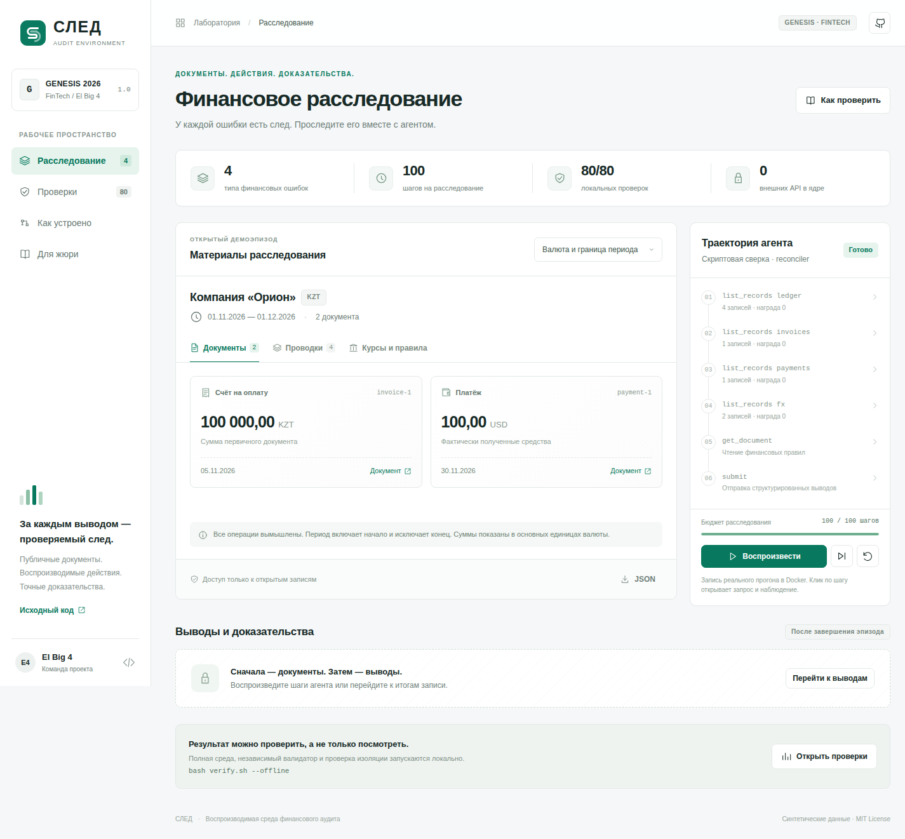
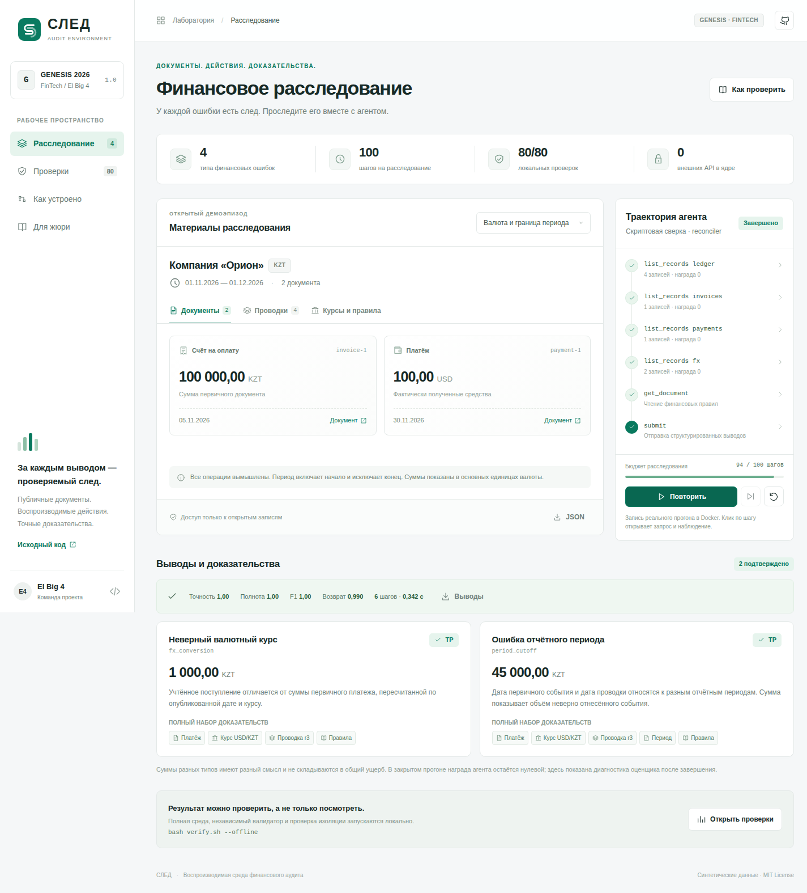
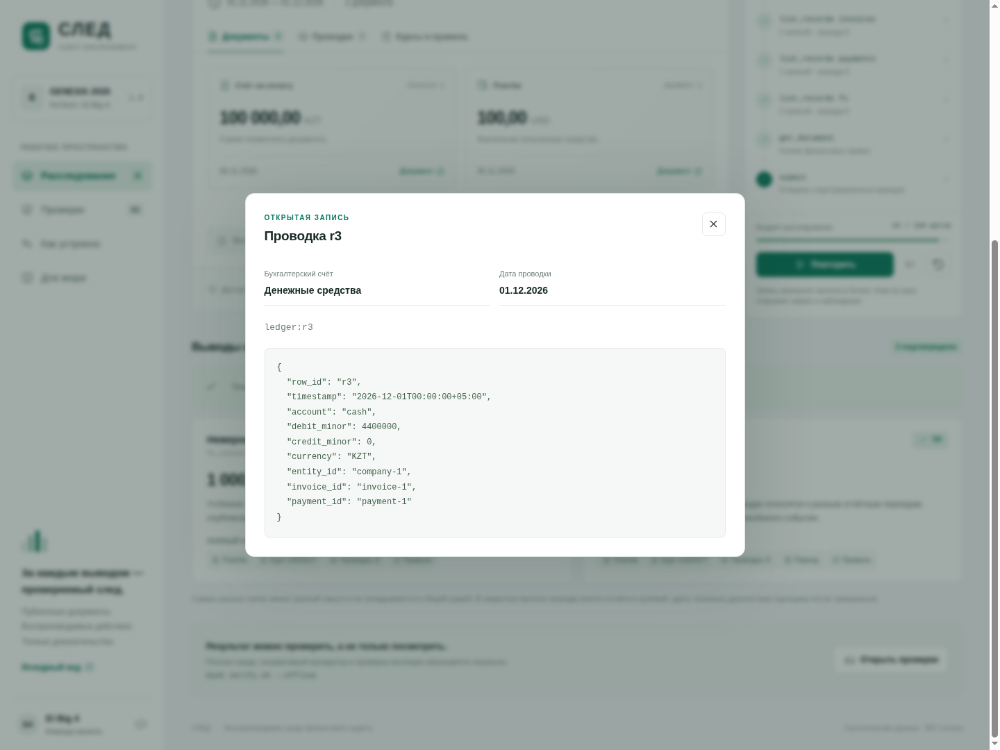
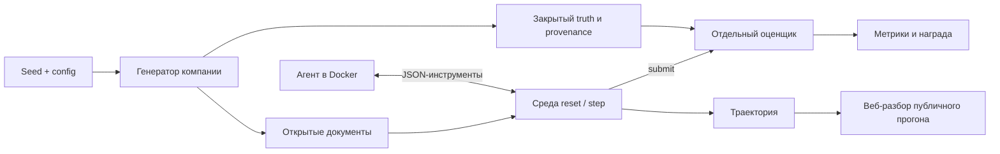

<div align="center">
  
  <h1>СЛЕД</h1>
  <p><strong>У каждой финансовой ошибки есть проверяемый след.</strong></p>
  <p>Воспроизводимая среда финансовых расследований · GENESIS 2026 / FinTech · El Big 4</p>
  <p>
    <a href="https://sled-genesis.vercel.app">Открыть веб-демо</a> ·
    <a href="#как-проверить-решение">Сценарий для жюри</a> ·
    <a href="demo/presentation.pdf">Презентация</a> ·
    <a href="demo/demo.mp4">Видео · 96 секунд</a>
  </p>
  <p><strong>4 типа ошибок · 48/48 тестов · 80/80 локальных проверок · 10 train + 10 dev</strong></p>
</div>



## О проекте

**СЛЕД — среда для разработки и проверки ИИ-аудиторов.** Чтобы агент научился
находить финансовые ошибки, ему нужны повторяемые задачи, инструменты
расследования и объективная оценка ответа. Реальные документы компаний обычно
закрыты, а достоверный эталон ошибки получить сложно.

Мы создаём вымышленную компанию с согласованной историей, вносим известные ошибки
и даём агенту расследовать их через ограниченный интерфейс. Отдельный оценщик
проверяет **тип, сумму, валюту, затронутые записи и доказательства** каждого вывода.
Качество формулировок не влияет на награду.

Проект предназначен для команд, которые разрабатывают финансовых агентов,
готовят RL-среды и проверяют надёжность автоматической сверки. В рамках кейса
главный результат — корректная и воспроизводимая среда.

> **Что открывается на Vercel:** интерактивный разбор реальных записанных прогонов
> на четырёх публичных эпизодах. Можно изучить документы, пройти шаги агента,
> открыть доказательства и посмотреть результаты проверки. Полная среда
> с Docker-изоляцией запускается локально по инструкции ниже.

## Что реализовано

| Возможность | Реализация |
| --- | --- |
| Четыре типа ошибок | Дубли счетов, пропущенное/частичное распределение платежа, неверный FX-курс или его дата, ошибка отчётного периода |
| Взаимодействующие ошибки | Дубль + распределение; FX + граница периода |
| Корректные отвлекающие случаи | Частичные и разбитые оплаты, возвраты переплаты, законные повторяющиеся суммы, явные `null`-ссылки |
| Причинная генерация | Сначала корректная история, затем изменения с `before/after` в закрытом provenance |
| RL-контракт | `reset(seed, config)` и `step(action)`; до 100 действий, страницы до 50 строк |
| Инструменты | `list_records`, `get_record`, `get_document`, безопасный `calculator`, `submit` |
| Строгое сопоставление | Взаимно однозначный matcher; дубли выводов — FP; необходим полный допустимый набор доказательств |
| Изоляция | Агент в Docker без сети и mounts, read-only корень, непривилегированный пользователь; оценщик в отдельном процессе |
| Четыре политики | Случайный исследователь, простая сверка, «пометить всё», доверенный oracle |
| Проверка самой среды | Независимый финансовый валидатор, ручные примеры, атакующие ответы, мутации, перестановки и переименование ID |
| Материалы | JSON-схемы, 20 учебных эпизодов, траектории, отчёты, PDF и MP4 |
| Веб-демо | Выбор эпизода, просмотр документов, поиск и пагинация проводок, воспроизведение шагов, раскрытие доказательств, скачивание JSON |

## Как работает решение

1. **Вход:** seed и конфигурация — размер компании, базовая валюта, период,
   количество ошибок каждого типа и отвлекающие случаи.
2. **Генерация:** создаются счета, платежи, проводки, таблица курсов и финансовая
   политика. Эталон и история изменений остаются у доверенной стороны.
3. **Расследование:** агент запрашивает записи через инструменты и расходует
   бюджет шагов. Прямого доступа к файлам эталона у него нет.
4. **Ответ:** агент отправляет `findings.json` с выводами, суммами и ID доказательств.
5. **Результат:** оценщик вычисляет TP, FP, FN, precision, recall, F1 и награду;
   действия и наблюдения сохраняются в `trajectories.jsonl`.

```text
reward = clip(2 × F1 − 1 − 0.002 × inspection_steps, −1, 1)
```

За исследование награда равна нулю. В режиме `train` политика получает настоящую
терминальную награду; в закрытом `evaluation` результат остаётся у оценщика.



<details>
<summary><strong>Открыть пример доказательства из исходной проводки</strong></summary>



Доказательство открывает исходную запись. Для ручного FX-эпизода в ней видны
4 400 000 минимальных единиц KZT и дата 1 декабря — именно эти значения
сравниваются с первичным платёжным документом и опубликованным курсом.

</details>

## Технологии

| Часть | Технологии |
| --- | --- |
| Ядро и тесты | Python 3.11, стандартная библиотека: `Decimal`, `Fraction`, `json`, `csv`, `unittest`, `subprocess` |
| Изоляция и поставка | Docker, Linux/cgroup v2, Bash; базовые образы закреплены digest |
| Форматы | JSON, JSONL, CSV, JSON Schema 2020-12; ISO-8601; целые minor units |
| Веб-интерфейс | HTML, CSS, JavaScript ES modules; без фреймворка и runtime-зависимостей |
| Хостинг демо | Vercel, статическая публикация каталога `web/` |
| Проверка интерфейса | Playwright, настольные и мобильные размеры экрана |
| Подготовка медиа | PyMuPDF 1.26.6 и FFmpeg; нужны только для пересборки PDF/видео |
| AI-модели и внешние API | Не используются в обязательном запуске. Политики скриптовые; обучение весов не выполняется |

Для работы среды не нужны API-ключи, платные сервисы или GPU.

## Архитектура проекта



Генератор использует десятичную арифметику, а независимый валидатор пересчитывает
финансовые расхождения через точные дроби. Валидатор сначала исследует публичные
документы и лишь затем сравнивает результат с эталоном. Простая политика сверки
имеет отдельную реализацию.

```text
src/sled/        генератор, среда, оценщик, валидатор и политики
fixtures/        три вручную рассчитанных эпизода
data/train/      10 открытых train-эпизодов
data/dev/        10 открытых dev-эпизодов
configs/         seed, конфигурации и SHA-256 файлов учебных данных
schemas/         схемы данных, действий, выводов и траекторий
tests/           регрессионные и контейнерные проверки
verification/    сохранённые результаты локальной приёмки
web/             статическое интерактивное демо для Vercel
scripts/         экспорт веб-демо, браузерная проверка и подготовка медиа
docs/            финансовые правила, контракт, дизайн и ограничения
demo/            видео, презентация и записи ручных прогонов
```

Подробнее: [устройство среды](docs/design.md), [контракт инструментов](docs/contract.md),
[финансовая модель](docs/accounting.md).

## Установка и запуск

### Полная среда

**Требования:** Linux, Python 3.11, Bash, работающий Docker и cgroup v2.
Сторонних Python-зависимостей для ядра и обязательных тестов нет.

```bash
git clone https://github.com/amurapan/genesis.git
cd genesis

# Собрать образы и выполнить полную проверку
bash verify.sh

# Повторить без сети с подготовленными образами
bash verify.sh --offline
```

При первом запуске может понадобиться сеть для получения базового образа.
Сами эпизоды выполняются без сети. Офлайн-команда сверяет fingerprints образов
с исходниками и отклоняет устаревшие образы.

Результаты появятся в `artifacts/release/report.html` и `report.json`.
Неисполненная обязательная проверка не засчитывается; ошибки дают ненулевой exit code.

### Отдельный эпизод

После подготовки Docker-образов:

```bash
export PYTHONPATH=src

# Ручной пример: валютный платёж на границе периода
python3 -m sled demo --fixture fixtures/manual_fx_period.json \
  --output artifacts/fx-period

# Чистый контрольный пример
python3 -m sled demo --fixture fixtures/manual_clean.json \
  --output artifacts/clean

# Новая компания и расследование
python3 -m sled generate --seed 19 --output artifacts/company
python3 -m sled demo --seed 19 --policy reconciler
```

У `demo` доступны `--policy reconciler|random|flag_all|oracle` и
`--mode train|evaluation`. Oracle запускается только на доверенной стороне.
Параметры генератора можно передать через `--config config.json`; `--clean`
отключает все четыре ошибки.

### Только веб-интерфейс

```bash
python3 -m http.server 4173 --directory web
# Открыть http://localhost:4173
```

Node.js и сборка не нужны. Сохранённые публичные прогоны уже включены в репозиторий.
Для обновления веб-данных после изменения ядра: `python3 scripts/export_web_demo.py`
с подготовленным образом агента.

### Офлайн-комплект

```bash
mkdir -p artifacts/demo-release
cp -R demo/. artifacts/demo-release/
PYTHONPATH=src python3 -m sled package
```

После полного прогона и подготовки медиа команда создаёт
`dist/sled-submission.zip`: исходники, данные, Docker-образы, отчёты и материалы
сдачи. Команда после распаковки — `bash run-offline.sh`.
Архив не включён в Git. Подробнее — [инструкция сдачи](docs/submission.md).

## Как проверить решение

### Сценарий для жюри: FX + граница периода

1. Откройте **[веб-демо](https://sled-genesis.vercel.app)** и выберите «Валюта и граница периода».
2. Откройте документы: счёт на **100 000 KZT**, платёж **100 USD** от 30 ноября.
3. Во вкладке «Курсы и правила» проверьте курс **450 KZT/USD**.
   Правильное поступление — **45 000 KZT**.
4. Во вкладке «Проводки» найдите **44 000 KZT** датой **1 декабря**.
5. Нажмите **«Воспроизвести»**. Агент пройдёт шесть записанных шагов и отправит
   два вывода. Нажмите на ID доказательств, чтобы открыть исходные записи.

| Ожидаемый вывод | Сумма | Почему |
| --- | ---: | --- |
| `fx_conversion` | 1 000 KZT | В книгу внесено 44 000 вместо 45 000 |
| `period_cutoff` | 45 000 KZT | Поступление ноября отражено за границей периода |

Ожидаемые метрики: **TP = 2, FP = 0, FN = 0, F1 = 1**. При пяти исследованиях
и одном `submit` терминальная награда оценщика равна **0,99**. Агент в закрытом
режиме видит нулевую награду. Суммы двух нарушений не складываются в «общий ущерб».

Для независимого повтора выполните локальную команду `demo` с тем же fixture.
Затем выберите «Чистая компания»: счёт 1 000 KZT, оплата 600 KZT, законный
остаток 400 KZT — **ни одного нарушения**.

### Проверка надёжности


| Проверка | Сохранённый результат |
| --- | ---: |
| Регрессионные и контейнерные тесты | 48 / 48, без пропусков |
| Локальная матрица приёмки | 80 / 80 |
| Четыре политики на общих 20 эпизодах | 80 запусков |
| Парные преобразования ID и порядка | 20 / 20 |
| Дополнительные эпизоды и преобразования | 200 / 200 |
| Выбранные намеренные дефекты | 10 / 10 обнаружены |
| Воспроизведение публичных траекторий | 20 / 20 |
| Предельный эпизод | 2 000 проводок, 200 документов, 12 ошибок |

Результаты, версии и hashes: [verification](verification/README.md).
Скриншоты сделаны с работающего интерфейса; суммы и метрики загружены из реальных
записей прогонов.

**80 собственных проверок дают 90/90 автоматических баллов нашей матрицы.**
Оставшиеся 10 инженерных баллов требуют просмотра человеком. Официальный набор
проверок жюри неизвестен; локальный результат не гарантирует оценку 100/100.
Высокая награда oracle показывает потолок награды, а не сложность среды.

## Данные и интеграции

- Все компании, операции, документы и курсы валют **синтетические**.
  Ручные примеры созданы отдельно от генератора.
- Открытые файлы эпизода: `manifest.json`, `ledger.csv`, `invoices.jsonl`,
  `payments.jsonl`, `fx.csv`, `policy.json`.
- Закрытые файлы оценщика: `truth.json` и `provenance.json`. В учебных наборах
  исследователь может их открыть; обычный агент их не получает.
- Деньги хранятся целыми минимальными единицами; FX-курсы — десятичными строками.
  Поддержаны KZT, USD, EUR, JPY и KWD с разрядностями 0/2/3.
- Банковские API, реальные платежи, финансовые аккаунты и персональные данные
  не используются. Ключи и регистрация для проверки не нужны.
- Vercel публикует только статическое веб-демо. GitHub хранит исходники и
  материалы. Эти сервисы не участвуют в офлайн-оценке эпизода.

## Ограничения

- Счета номинированы в базовой валюте; иностранная валюта поддержана для платежей.
- Платёж ссылается максимум на один счёт либо имеет явный `null`. Возврат
  относится только к ранее нераспределённой переплате.
- Нет налогов, банковских комиссий, кредит-нот и переоценки валютных счетов.
- Часовой пояс задаётся фиксированным смещением; переходы DST не моделируются.
- Веб-демо воспроизводит публичные записи; генерация новых закрытых эпизодов,
  контейнерная изоляция и обучение не запускаются на Vercel.
- Веса моделей не обучались; улучшение модели после RL не заявляется.
- Продукт не является профессиональным аудиторским заключением.
- Доверенная граница включает Linux, Docker daemon, launcher и оценщик;
  защита от уязвимостей ядра или container escape не заявляется.

Подробно: [ограничения](docs/limitations.md), [измеренный разбор сбоев](docs/failures.md).

## Deployed-версия

**Веб-демо:** [https://sled-genesis.vercel.app](https://sled-genesis.vercel.app)
**Исходники:** [github.com/amurapan/genesis](https://github.com/amurapan/genesis)

Конфигурация Vercel находится в `vercel.json`: публикуется каталог `web/`,
установка зависимостей и сборка не требуются. Публикация своей копии через
[Vercel CLI](https://vercel.com/docs/cli/deploy):

```bash
vercel link
vercel deploy --prod
```

---

**Команда:** El Big 4 · **Хакатон:** GENESIS.EXE 2026 · **Кейс:** FinTech
**Лицензия:** [MIT](LICENSE)
